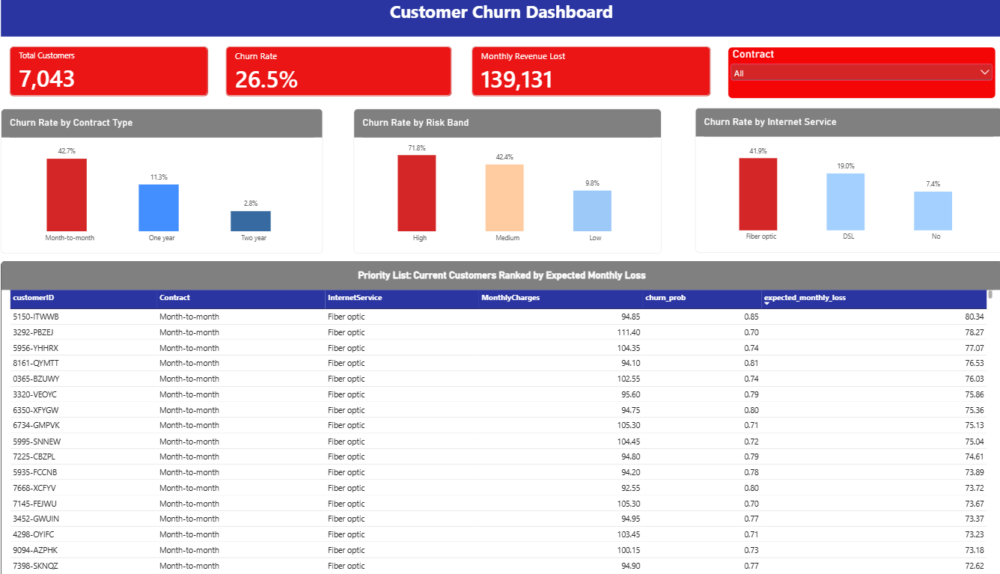

# Customer Churn Analysis and Retention Priority List

An end-to-end analytics project that finds **why customers leave**, predicts **who is likely to leave next**, and ranks current customers by **expected monthly revenue at risk**, so a retention team knows who to contact first.

**Tools:** Excel · MySQL · Python (pandas, scikit-learn) · Power BI

<!-- Replace dashboard.png with your Power BI screenshot saved in the repo -->

---

## Business question

Which customers are likely to churn, and which of them are most valuable to keep?

## Dataset

Telco Customer Churn (IBM sample dataset, available on Kaggle): 7,043 customers, 21 columns covering contract, services, billing, tenure, and whether the customer churned (`Churn` = Yes / No).

## Workflow

| Stage | Tool | What I did |
|---|---|---|
| 1. Clean and explore | Excel | Checked size and types, found 11 hidden blank `TotalCharges` values (all customers with tenure 0, stored as text), filled them with 0, confirmed no duplicate customer IDs, built pivot tables |
| 2. Query | MySQL | Loaded the cleaned data into a `customers` table and used `GROUP BY`, `CASE WHEN`, and `WHERE` to calculate churn rates and revenue lost; matched the Excel results exactly |
| 3. Model | Python | One-hot encoded categorical columns, trained a logistic regression on an 80/20 stratified split, evaluated it against a baseline, and scored every customer with a churn probability |
| 4. Report | Power BI | Built a dashboard with KPI cards (customers, churn rate, monthly revenue lost), a contract filter, churn rate by contract, risk band, and internet service, and a ranked priority table |

## Key findings

- **Overall churn is 26.5%** (1,869 of 7,043 customers).
- **Contract type is the strongest signal:** month-to-month customers churn at **42.7%**, versus **11.3%** (one year) and **2.8%** (two year).
- **Fiber optic customers churn at 41.9%**, versus 19.0% for DSL and 7.4% for customers with no internet service.
- **Fiber optic + month-to-month is the riskiest segment:** 54.6% churn across 2,128 customers.
- **Churned customers paid more:** average monthly charge of 74.44, versus 61.27 for customers who stayed.
- **Revenue at risk:** churned customers represent about **139,131 in monthly charges**, and about **87% of it comes from month-to-month contracts**.

## Model

- **Model:** logistic regression (with feature scaling), 5,634 training rows and 1,409 test rows
- **Accuracy:** 0.807, against a baseline of 0.735 for always predicting "no churn"
- **ROC AUC:** 0.842
- **Churn recall / precision at a 0.5 cut-off:** 0.57 / 0.66. Lowering the cut-off trades precision for recall (0.3 gives recall 0.75 and precision 0.52), so the right cut-off depends on the cost of contacting a customer versus the revenue lost.
- **Main drivers:** tenure, contract type, and fiber optic internet.

### Risk bands (actual churn rate by predicted risk)

| Band | Churn probability | Customers | Actual churn rate |
|---|---|---|---|
| Low | up to 0.3 | 4,370 | 9.8% |
| Medium | 0.3 to 0.6 | 1,631 | 42.4% |
| High | above 0.6 | 1,042 | 71.8% |

## Priority list

Current customers (`Churn` = No) are ranked by:

> **expected monthly loss = churn probability × monthly charges**

This puts high-risk, high-value customers first. For example, a customer with an 85% churn probability paying 94.85 per month has an expected monthly loss of about 80.

## Limitations

- The data is a sample dataset, so results show patterns, not business-specific truths.
- Results show **association, not cause**. For example, fiber customers churn more, but the data can't say why.
- Coefficients of overlapping features (such as monthly charges, total charges, and services) should not be read one by one.
- Risk-band churn rates use the same data the model learned from, so they look slightly better than they would on brand-new customers. Accuracy and ROC AUC are measured on the held-out 20%.

## Repository contents

- `churn_queries.sql`: MySQL queries
- `churn_model.ipynb`: Python notebook (cleaning, modelling, scoring)
- `priority_list.csv`: ranked list of current customers
- `churn_dashboard.pbix`: Power BI dashboard
- `dashboard.png`: dashboard screenshot

## How to run

1. Download the Telco Customer Churn dataset from Kaggle and save the cleaned version as a CSV in the project folder.
2. Run `churn_queries.sql` in MySQL Workbench to reproduce the SQL analysis.
3. Open `churn_model.ipynb` in Jupyter. Update the file path at the top to point to your CSV, then run all cells.
4. Open `churn_dashboard.pbix` in Power BI Desktop (refresh the data source path if prompted).

## Author

Md Reyaz Ahmad
